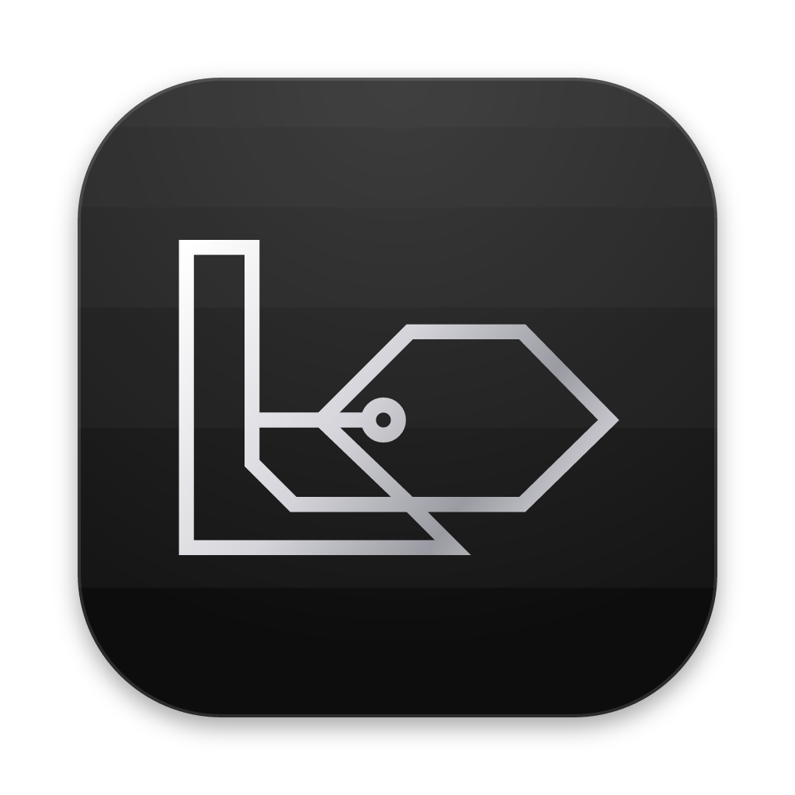

<p align="center">
  
</p>

<h1 align="center">Laya Notes</h1>

<p align="center">
  Markdown notes that tag themselves, with a small AI model that runs on your own computer.
</p>

<p align="center">
  <a href="https://itsdula.github.io/laya-notes/"><strong>Website</strong></a> ·
  <a href="https://github.com/itsdula/laya-notes/releases/latest"><strong>Download</strong></a> ·
  <a href="docs/architecture.md">How it works</a>
</p>

<p align="center">
  <a href="https://github.com/itsdula/laya-notes/releases/latest"></a>
  <a href="https://github.com/itsdula/laya-notes/actions/workflows/release.yml"></a>
  <a href="LICENSE"></a>
</p>

---

Laya Notes keeps every note as a plain Markdown file in a folder you choose. A small AI model, [Laya](https://huggingface.co/receptron/laya-onnx), runs inside the app, reads each note and adds the tags that fit. There is no account and no server, and after a one-time model download it works offline.

- **Your notes are files.** Each note is a `.md` file and each folder is a real folder. Open them in any editor, back them up, or keep them in a folder your own sync service already covers.
- **Tags are questions.** A tag is a yes-or-no question, like "Is this note about a trip?". Laya answers every question for a note in one pass and keeps the tags it is confident about.
- **Private by design.** Notes never leave your computer. The only network request is the model download, about 1.6 GB, once per computer.

## Download

| Platform | File |
|---|---|
| macOS, Apple Silicon (M1 or later), macOS 12+ | [Laya-Notes-mac-arm64.dmg](https://github.com/itsdula/laya-notes/releases/latest/download/Laya-Notes-mac-arm64.dmg) |
| Windows 10 or 11, 64-bit | [Installer (.exe)](https://github.com/itsdula/laya-notes/releases/latest/download/Laya-Notes-windows-x64-setup.exe) or [portable (.zip)](https://github.com/itsdula/laya-notes/releases/latest/download/Laya-Notes-windows-x64.zip) |
| Debian and Ubuntu, 64-bit | [Laya-Notes-linux-amd64.deb](https://github.com/itsdula/laya-notes/releases/latest/download/Laya-Notes-linux-amd64.deb) |

The builds are not code-signed yet, so the first launch needs one extra step:

- **macOS:** if the app will not open, go to System Settings → Privacy & Security and click **Open Anyway**.
- **Windows:** if SmartScreen says "Windows protected your PC", click **More info**, then **Run anyway**.

## Development

You need Node.js 22.18 or newer.

```sh
npm ci
npm run dev
```

`npm run dev` prints two addresses: a dev monitor that shows every log line from the app, and a local copy of the landing page. The app window opens on its own.

| Command | What it does |
|---|---|
| `npm run dev` | Runs the app with the dev monitor and the landing page |
| `npm test` | Runs the Vitest suite |
| `npm run typecheck` | Type-checks the app and the build scripts |
| `npm run make` | Builds installers for the current platform into `out/make` |
| `npm run icons` | Redraws the app icons and favicons from the logo |

### Project layout

| Folder | Contents |
|---|---|
| `src/main` | Electron main process: settings, the notes folder, the model download and tagging |
| `src/model-worker` | The utility process that runs Laya through ONNX Runtime |
| `src/preload` | The typed bridge between the window and the main process |
| `src/renderer` | The React window, built with shadcn/ui |
| `src/shared` | Types and schemas used on both sides of the bridge |
| `site` | The landing page, published with GitHub Pages |
| `scripts` | The dev runner and the icon generator |
| `docs` | [Architecture](docs/architecture.md) and the [build plan](docs/plan.md) |

### Releasing

Pushing a tag such as `v0.2.0` runs the [Release workflow](.github/workflows/release.yml). It tests and builds on macOS, Windows and Linux, then creates a draft release with every installer. Publish the draft once the files are checked. The landing page always links to the latest published release.

## Credits

Tagging uses [Laya](https://huggingface.co/receptron/laya-onnx), a decision model by Convai Innovations, through [`@receptron/laya`](https://github.com/receptron/laya).

## License

[MIT](LICENSE)
